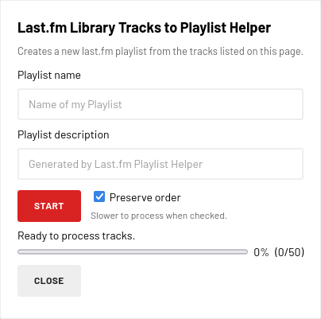

# Last.fm Library Tracks to Playlist Helper

A userscript that helps creating a Last.fm playlist from the tracks in your Last.fm library.

It iterates over the tracks displayed on a Last.fm Library Tracks page and creates a Last.fm playlist from them.

  

## Install

- Install a userscript manager such as [Violentmonkey](https://violentmonkey.github.io/) or [Tampermonkey](https://www.tampermonkey.net/).
- Open the [raw userscript URL](https://github.com/jjnilton/lastfm-library-tracks-to-playlist-helper/raw/refs/heads/main/userscript.user.js).

## Usage

- Go to Last.fm's Library Tracks page: `https://www.last.fm/user/<your-user>/library/tracks`.
- Filter the tracks by date range, page, etc.
- Click the Create Playlist button added by the userscript.
- Then fill in the Create Playlist form.

The new playlist will be available at `https://www.last.fm/user/<your-user>/playlists`.
